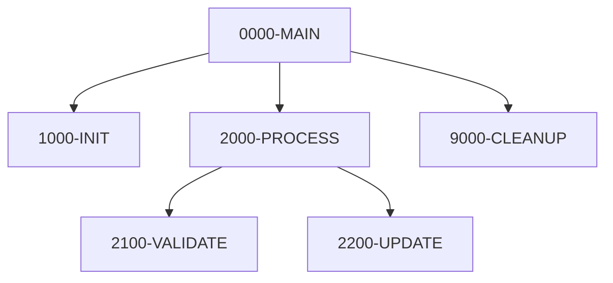
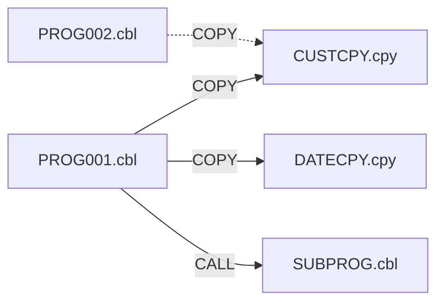
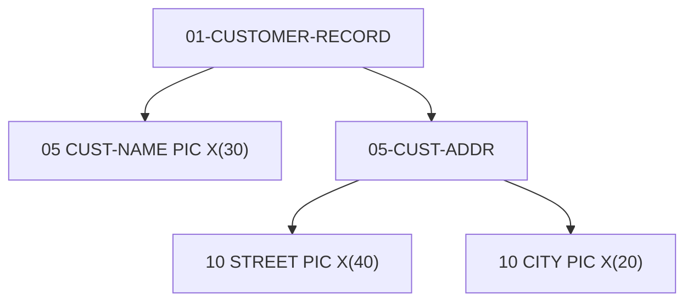
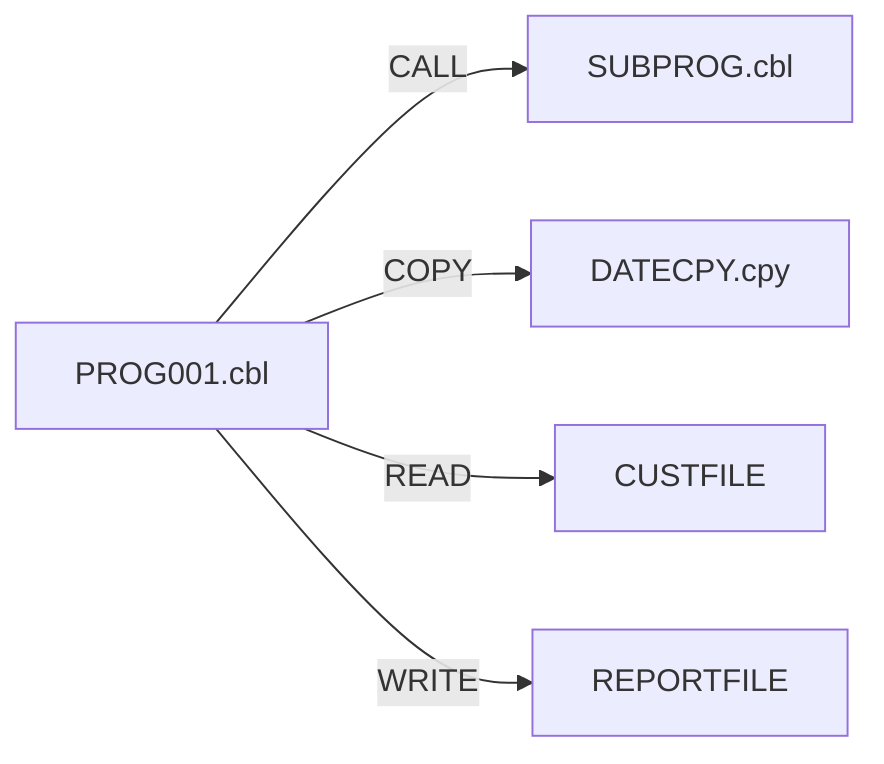

# Diagrams

OpenCob can generate Mermaid diagrams directly from your source code — no manual diagramming required. It supports COBOL, RPG, PL/I, CL, BMS, DDS, and modern languages (TypeScript, Python, Java, Go).

## Quick Start

1. Open any supported file in the editor
2. Right-click → **OpenCob: Generate Diagram** (or use the editor title button)
3. Pick a diagram type from the QuickPick — the recommended type is shown
4. A Mermaid preview opens in a side panel

## Supported File Types

### Legacy (34 extensions)

| Category  | Extensions                                                                        |
| --------- | --------------------------------------------------------------------------------- |
| COBOL     | `.cob`, `.sbc`, `.ccp`, `.ccc`, `.cbe`, `.cbl`, `.cpy`, `.sqb`, `.pco`, `.cblcpy` |
| RPG       | `.rpg`, `.rpgle`, `.sqlrpgle`, `.sqlrpg`                                          |
| PL/I      | `.pli`, `.pl1`, `.inc`                                                            |
| CL        | `.clle`, `.clp`, `.cmd`, `.mnu`                                                   |
| Mainframe | `.map`, `.asm`, `.rma`, `.obs`, `.rmc`                                            |
| DDS       | `.dds`, `.pf`, `.lf`, `.dspf`, `.prtf`                                            |

### Modern (9 extensions)

`.ts`, `.tsx`, `.js`, `.jsx`, `.mjs`, `.cjs`, `.py`, `.java`, `.go`

## Diagram Types

### control_flow

Shows paragraph/section PERFORM chains or procedure call sequences.



**Section picker**: When a file has multiple divisions/sections, OpenCob shows a picker so you can diagram a single section instead of the whole file.

### dependency_map

Visualizes COPY/INCLUDE dependencies and CALL targets. Includes **inbound references** — other files in the same workspace that COPY or CALL into the current file.



### data_structure

Renders the WORKING-STORAGE / LINKAGE hierarchy as a tree, showing PIC clauses and level numbers.



### copybook_tree

Similar to dependency_map but focuses specifically on COPY/INCLUDE chains (nested copybook hierarchies). Also shows inbound references.

### screen_layout

Renders BMS/DDS screen maps as ASCII art:

```
┌────────────────────────────────────────────────────────────┐
│ CUSTOMER INQUIRY                                            │
│                                                             │
│ Customer ID: [__________]                                   │
│ Name:        [______________________________]               │
│ Balance:     [____________]                                 │
│                                                             │
│ F3=Exit  F5=Refresh  F12=Cancel                            │
└────────────────────────────────────────────────────────────┘
```

### usage_map

Shows **outgoing** references: what the current file calls, copies, and reads/writes.



## Content-Based Availability

Not every diagram type applies to every file. OpenCob inspects the actual file content to determine which types are relevant:

- **control_flow** — requires PERFORM statements or procedure calls
- **dependency_map** — requires COPY/CALL/INCLUDE/import references
- **data_structure** — requires WORKING-STORAGE, LINKAGE, or struct definitions
- **copybook_tree** — requires COPY or INCLUDE statements
- **screen_layout** — requires BMS DFHMSD/DFHMDI macros or DDS screen keywords
- **usage_map** — requires any outgoing reference (CALL, COPY, READ, WRITE, import)

The QuickPick shows `(recommended: <type>)` based on what the file actually contains.

## Programmatic API

For EE/web/CLI consumers, a stable API is exported from `@opencob/core`:

````typescript
import {
  listAvailableTypes,
  generateDiagram,
  listSections,
  invalidateDiagramCache,
  clearDiagramCache,
} from '@opencob/core';

// Check which diagram types apply to this file
const availability = await listAvailableTypes('PROG001.cbl', source);
// → { available: ['control_flow', 'dependency_map', 'usage_map'], recommended: 'control_flow' }

// Generate a specific diagram
const result = await generateDiagram('PROG001.cbl', source, 'control_flow');
// → { success: true, content: '```mermaid\ngraph TD\n...```', metadata: {...} }

// List extractable sections (for control_flow section picker)
const sections = listSections('PROG001.cbl', source);
// → [{ name: '0000-MAIN', startLine: 45, endLine: 120 }, ...]

// Cache management
invalidateDiagramCache('PROG001.cbl', source);
clearDiagramCache();
````

### Caching

Diagrams are cached by a SHA-256 hash of `filename + content + diagramType`. Cache entries expire after **5 minutes** or when the file changes. The cache holds up to 100 entries with LRU eviction.

## Tips

- **Large programs**: Use the section picker to focus on one division at a time
- **Cross-program dependencies**: Open the dependency_map to see both outbound and inbound references
- **Change impact**: Generate a usage_map before refactoring to see everything that depends on the file
- **Modern files**: TypeScript/Python/Java/Go files support `control_flow`, `dependency_map`, and `data_structure`
- **Performance**: Repeated requests for the same file are served from cache instantly
